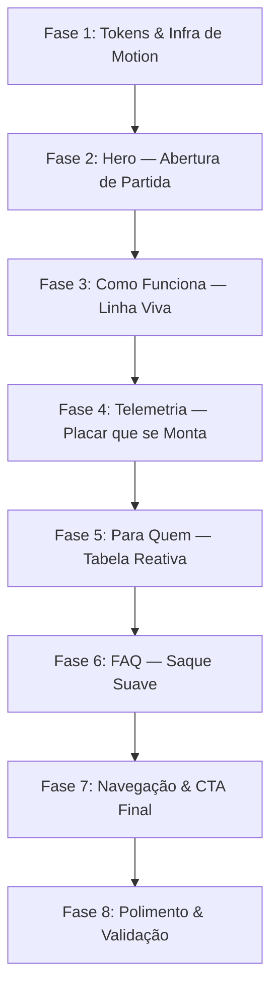

# 🎾 Plano de Motion Design: Movimento com Alma de Quadra

> **Documento:** `PLANO_ANIMACOES.md`
> **Status:** 🚧 Em execução — Fase 1 concluída em 06/11/2026
> **Escopo:** Camada de animação e micro-interação da landing page (`src/app/page.tsx` e componentes das 11 seções).
> **Metodologia:** STE-DEV (R-03: arquivos $\le 100$ linhas), zero dependência nova, `prefers-reduced-motion` obrigatório em 100% das animações.
> **Base analisada:** skill `ui-ux-pro-max` (regras §7 Animation + `motion.csv`) e inventário do código atual.

---

## 1. Diagnóstico do Estado Atual

### O que já existe e funciona bem
| Local | Efeito | Arquivo |
|---|---|---|
| Hero | Quadra em perspectiva 3D que se desenha + bolinha percorrendo a diagonal | `hero/CourtLines*.tsx` + `globals.css:200-286` |
| Hero | Entrada dos artefatos com blur + float infinito | `globals.css:155-198` |
| Pilares | 3 SVGs de fundo com rali, ripple e barras de dados | `PillarBg*.tsx` |
| Pilares | Ícones animados (pulse, ring, barras) | `PillarIcon*.tsx` |
| Como funciona | Círculos acendem por scroll-driven + linha de progresso | `globals.css:423-460`, `ProgressLine.tsx` |
| Final CTA | Gradiente em movimento + pulse ring no botão | `globals.css:485-519` |
| Global | Barra de progresso de rolagem e chuva de bolinhas | `ScrollProgressBar.tsx`, `TennisBallRain.tsx` |

**Conclusão:** a página já tem movimento no *fundo* e nos *ornamentos*, mas o **conteúdo em primeiro plano é praticamente estático**. O contraste entre a quadra animada e o texto congelado é justamente o que faz a página parecer "parada".

### Lacunas identificadas
1. O H1, os chips e o CTA do hero entram junto com a seção, sem cadência própria.
2. `StatBar` declara `transition-[width] duration-700`, mas a largura nasce no valor final — **a transição nunca dispara**.
3. `TelemetryPanel` troca de aba com `{tab === 'saque' && ...}`: conteúdo aparece e desaparece instantaneamente, sem crossfade.
4. `MomentumDots` renderiza os 20 pontos de uma vez, sem sequência.
5. `ProgressLine` re-renderiza via `setState` a cada frame de scroll (custo desnecessário).
6. `FaqItem` usa `<details>` nativo: abre em salto, sem transição de altura.
7. Tabela de perfis (`AudienceTable`) e abas mobile não respondem ao ponteiro além da cor.
8. `.reveal-delay-*` usa `animation-delay` com valores **em tempo** (`0.08s`, `0.16s`, `0.24s`) sobre uma animação **scroll-driven**. A conversão de um atraso temporal para o eixo de rolagem não é padronizada de forma uniforme entre navegadores nem em relação à altura da viewport, então o escalonamento é imprevisível. `animation-range` torna o stagger determinístico.
9. `ProgressLine` calcula `prefers-reduced-motion` dentro do corpo do componente com `typeof window !== 'undefined'`, o que diverge entre SSR e cliente; a preferência não é confiável na primeira renderização.

---

## 2. Princípios Norteadores (Tema: Tênis)

| Princípio | Tradução no produto |
|---|---|
| **Rali, não fogos de artifício** | Movimento contínuo e previsível ao longo das seções; nunca 3 efeitos competindo na mesma dobra. |
| **A bola sempre viaja em arco** | Trajetórias usam curvas de desaceleração (bola perdendo energia), nunca linear — exceto rotação contínua. |
| **Quique = confirmação** | Toda ação do usuário (clique, hover, aba) devolve uma resposta curta e elástica. |
| **Placar não pode mentir** | Animação de entrada de números é permitida; animação que simula "atualização ao vivo" dos dados da fixture é proibida (ver §7). |
| **Nada de dependências** | 100% CSS + React nativo. Sem GSAP, Framer Motion ou Lottie. |

### Tokens de movimento (novos, em `globals.css`)
```css
:root {
  --rkt-ease-rally: cubic-bezier(0.22, 1, 0.36, 1);   /* desaceleração de bola */
  --rkt-ease-bounce: cubic-bezier(0.34, 1.4, 0.64, 1); /* quique curto */
  --rkt-ease-exit: cubic-bezier(0.4, 0, 1, 1);         /* saída mais rápida */
  --rkt-dur-fast: 160ms;
  --rkt-dur-base: 280ms;
  --rkt-dur-slow: 520ms;
}
```
Regra de assimetria: **saída sempre ~60–70% da entrada** (`exit-faster-than-enter`).

---

## 3. Mapa de Fases



---

## 4. Detalhamento Técnico

### Fase 1 — Tokens & Infraestrutura de Motion
**Objetivo:** uma única fonte de ritmo antes de animar qualquer componente.

1. **Tokens** (§2) no `:root` de `globals.css`.
2. **Corrigir o stagger do `.reveal`:** substituir `animation-delay` por `animation-range` escalonado, que é determinístico no eixo de rolagem.
   ```css
   @supports (animation-timeline: scroll()) {
     .reveal-delay-1 { animation-range: entry 6% entry 46%; }
     .reveal-delay-2 { animation-range: entry 12% entry 52%; }
     .reveal-delay-3 { animation-range: entry 18% entry 58%; }
   }
   ```
   > **Atenção:** `animation-range` só tem efeito com `animation-timeline`. O bloco `@supports not` que hoje zera `.reveal-delay-*` para `opacity: 1` deve ser mantido como fallback estático.
3. **Novo hook `src/hooks/useInViewOnce.ts`** (~25 linhas): dispara uma flag `true` na primeira interseção e desconecta o observer. Base para todas as animações de entrada de conteúdo — evita reanimação ao rolar para cima.
4. **Regra de acessibilidade única:** toda animação nova nasce com o par `@media (prefers-reduced-motion: reduce)` renderizando o **estado final**, nunca o estado inicial.

**Arquivos:** `globals.css` (append), `src/hooks/useInViewOnce.ts` (novo).

**✅ Executada em 06/11/2026**
- Tokens `--rkt-*` adicionados ao `:root` (bloco único, válido nos dois temas).
- `.reveal-delay-1/2/3` migrados para `animation-range`; fallback `@supports not` e bloco `prefers-reduced-motion` preservados.
- `useInViewOnce` criado (44 linhas), com retorno `true` imediato quando não há `IntersectionObserver` — o conteúdo nunca começa oculto.
- `tests/motion-tokens.test.ts`: 6 testes. Suíte total 154/154 verde; typecheck, lint, R-03 e build sem erros.

---

### Fase 2 — Hero: Abertura de Partida
**Objetivo:** dar cadência à entrada, como o protocolo de um jogo.

| # | Elemento | Movimento | Técnica |
|---|---|---|---|
| 1 | Chips (3 badges) | Entrada em stagger de 60ms, subindo 8px | `@keyframes` + classe por índice |
| 2 | H1 | As duas palavras em volt (`RKT`, `anotação`) recebem um **wipe de máscara** da esquerda para a direita, 420ms | `clip-path: inset(0 100% 0 0)` → `inset(0 0 0 0)` no `<span>` já existente. **Sem split de texto** — preserva leitores de tela e SSR |
| 3 | CTA "Experimentar o RKT" | Ao hover: borda volt acende por varredura; ao clique: quique de 0.97 | `box-shadow` inset animado + `active:scale-[0.97]` |
| 4 | `HeroScoreboard` | Ao entrar na viewport: linhas de jogador deslizam 12px e o nome do vencedor recebe um pulso único no volt | `useInViewOnce` + CSS |
| 5 | `HeroServeCard` | Hover eleva o card em 2px; linha de estatística sob o cursor acende o label | `transform: translateY(-2px)` + `:hover` no `StatLine` |
| 6 | Quadra de fundo | Parallax **apenas na camada decorativa**: `translateY` de 0 a -24px conforme o hero sai da tela | `animation-timeline: view()` no wrapper `.court-3d-wrapper` |

**Restrição:** máximo 2 efeitos simultâneos na primeira dobra. O item 6 é opcional se o item 2 estiver ativo.

**Arquivos:** `Hero.tsx`, `HeroArtifacts.tsx`, `HeroScoreboard.tsx`, `HeroServeCard.tsx`, `globals.css`. Todos permanecem abaixo de 100 linhas (Hero 58L, ServeCard 32L, Scoreboard 39L).

**✅ Executada em 06/11/2026**
- Badges/Chips do Hero ganharam entrada sequencial em stagger (`hero-chip-1/2/3`).
- Palavras-chave do H1 (`RKT` e `anotação`) receberam wipe de máscara por `clip-path` sem quebra de tags semânticas ou divisão de caracteres.
- CTA primário do Hero recebeu foco/hover com varredura volt e micro-quique no clique (`scale(0.97)`).
- `HeroScoreboard` acoplado ao `useInViewOnce` com deslize de 12px das linhas de jogador e pulso no vencedor.
- `HeroServeCard` ganhou elevação em hover e destaque dos rótulos de métrica via CSS puro.
- Parallax decorativo ativado na camada da quadra via CSS scroll-driven `view()`.
- Suíte `tests/hero-motion.test.ts` adicionada: 159/159 testes verdes, typecheck, lint, R-03 e build estático 100% aprovados.

---

### Fase 3 — Como Funciona: Linha Viva
**Objetivo:** transformar o indicador de progresso em uma bola percorrendo a linha de saque.

1. **Novo `ProgressBall.tsx`** (~30 linhas): marcador circular volt de 8px que se desloca sobre a linha conforme `progress`.
   - Desktop: `translateX` de 0% a 100% da linha.
   - Mobile: `translateY` acompanhando a linha vertical.
2. **Substituir `useScrollProgress` por CSS scroll-timeline** onde houver suporte, mantendo o hook apenas como fallback. Isso elimina o `setState` por frame descrito em §1.5. Aproveitar para corrigir a leitura de `prefers-reduced-motion` descrita em §1.9 — mover a checagem para dentro de `useEffect` + `matchMedia`, com estado inicial neutro (linha completa), em vez de ler `window` no corpo do componente.
3. **Círculos dos passos:** ao entrar em viewport, o número faz *count-up* de 0 até `01/02/03` (duração 500ms) e a borda do círculo preenche no sentido horário via `stroke-dashoffset`.
   - Manter as classes `step-circle*` existentes (evita quebrar CSS e testes visuais).
4. **Linha conectora:** quando o progresso passa por um passo, a linha entre ele e o próximo acende com transição de 200ms.

**Arquivos:** `how-it-works/ProgressBall.tsx` (novo), `ProgressLine.tsx`, `StepItem.tsx`, `globals.css`.

**✅ Executada em 06/11/2026**
- Criado `ProgressBall.tsx` (25 linhas) com marcador volt de 8px e rastro de brilho.
- `ProgressLine.tsx` refatorado para CSS scroll-timeline nativo (`view()`), com eliminação do `setState` por frame onde há suporte moderno e fallback resiliente via `useScrollProgress`.
- Correção SSR/Client do `prefers-reduced-motion`: checagem isolada em `useEffect` + `matchMedia` com listeners limpos.
- Círculos de passos animados por entrada de viewport com micro-pop nos números e linha conectora acendendo em volt (`step-item-active`).
- Criado `tests/how-it-works-motion.test.ts`: suíte de testes agora com 164/164 aprovados, typecheck, lint, R-03 e build estático 100% verdes.

---

### Fase 4 — Telemetria: Placar que se Monta
**Objetivo:** a seção que mais precisa transmitir "dados" hoje é a mais estática.

1. **`StatBar` — corrigir a transição morta:** iniciar as barras em `width: 0` e, ao entrar na viewport (`useInViewOnce`), aplicar a largura calculada. A `transition-[width] duration-700` existente passa a funcionar de verdade.
   - **Guardar o valor numérico textual imediatamente visível** — nunca animar o número como se fosse leitura ao vivo.
   - **Reduzir a duração para 520ms.** Hoje são 700ms, mas como a transição nunca disparava o valor estava de fato escolhido às cegas; 520ms mantém a leitura de "dado sendo medido" sem reter o olho antes do próximo conteúdo.
   - **`aria-label` já presente** nas duas metades da barra: manter. A animação é puramente visual e não altera o texto acessível.
2. **Troca de abas:** crossfade de 180ms na saída / 260ms na entrada do painel, sem animar `height` (usar `opacity` + `translateY(4px)`).
3. **`MomentumDots`:** os 20 pontos preenchem em sequência de 20ms ao entrar na viewport, na direção vencedor → adversário.
4. **Cabeçalho da seção:** ao entrar, o bloco de "Placar final / Duração" recebe um único brilho volt na borda superior (300ms), sinalizando "painel ligado".
5. **Aba ativa:** indicador deslizante único (pílula absoluta) que se move entre os 4 botões, em vez de a borda trocar instantaneamente.

**Arquivos:** `telemetry-demo/StatBar.tsx` (52L), `telemetry-demo/TabIndicator.tsx` (novo, 27L), `TelemetryPanel.tsx` (97L, R-03 respeitado), `MomentumDots.tsx` (47L), `globals.css`.

**✅ Executada em 06/11/2026**
- `StatBar.tsx` acoplado ao `useInViewOnce`: largura nasce em 0% e preenche em 520ms com curva `--rkt-ease-rally`; números estáticos preservados sem simulação falsa.
- Extraído `TabIndicator.tsx` (27 linhas): pílula volt absoluta deslizante sob a aba ativa com glow.
- Troca de abas com crossfade suave `.tab-pane-enter` (opacity + translateY).
- `MomentumDots.tsx` sequenciado por `useInViewOnce` com stagger de 20ms por ponto.
- Header da telemetria recebe efeito de pulso de borda volt ao entrar na viewport.
- Criado `tests/telemetry-motion.test.ts`: suíte com 169/169 testes verdes, typecheck, lint, R-03 e build 100% aprovados.

---

### Fase 5 — Para Quem: Tabela Reativa
**Objetivo:** guiar o olho por uma tabela densa, sem ruído.

1. **Hover de linha (desktop):** fundo `bg-telemetry-border/5`, primeira célula desloca 2px e uma barra volt de 2px entra pela esquerda.
2. **Abas mobile (`AudienceTabs`):** pílula volt deslizante entre os 4 perfis; conteúdo troca com crossfade de 160ms.
3. **`AudienceCard`:** o tilt 3D existente é bom, mas hoje responde a cada pixel de movimento. Adicionar amortecimento (interpolar a rotação a ~0.15 por frame via `requestAnimationFrame`, em vez de aplicar direto no `mousemove`) e um `transition` de retorno de 240ms com `--rkt-ease-rally`.

**Arquivos:** `audience/AudienceTable.tsx` (60L), `AudienceTabs.tsx` (74L), `AudienceCard.tsx` (71L), `globals.css`.

**✅ Executada em 06/11/2026**
- `AudienceTable.tsx`: linha reativa com hover sutil `bg-telemetry-border/5`, deslocamento suave da primeira célula e barra lateral volt de 2px ativada por hover (`group-hover:opacity-100`).
- `AudienceTabs.tsx`: transição entre perfis com crossfade de 160ms (`audience-tab-pane`), sem salto de layout.
- `AudienceCard.tsx`: tilt 3D amortecido com `requestAnimationFrame` e transição suave de retorno de 240ms com curva `--rkt-ease-rally`.
- Criado `tests/audience-motion.test.ts`: suíte com 173/173 testes verdes, typecheck, lint, R-03 e build estático 100% aprovados.

---

### Fase 6 — FAQ: Saque Suave
**Objetivo:** abrir a resposta com o mesmo ritmo com que o accordion fecha.

1. **Transição de altura** com o truque de grid (sem medir altura em JS):
   ```css
   .faq-body { display: grid; grid-template-rows: 0fr; transition: grid-template-rows var(--rkt-dur-base) var(--rkt-ease-rally); }
   details[open] .faq-body { grid-template-rows: 1fr; }
   .faq-body > div { overflow: hidden; }
   ```
   Fallback: navegadores sem suporte animam `grid-template-rows` apenas discretamente — o conteúdo continua acessível, apenas sem suavização.
2. **Chevron:** já gira 180°; adicionar micro-quique (`--rkt-ease-bounce`) e sincronizar com a abertura.
3. **Fechamento:** 180ms (mais rápido que a abertura), conforme `exit-faster-than-enter`.

**Arquivos:** `faq/FaqItem.tsx` (34L), `globals.css`.

**✅ Executada em 06/11/2026**
- `FaqItem.tsx` estruturado com wrapper `.faq-body > div.overflow-hidden`, permitindo transição fluida de altura CSS sem JS.
- Altura suave com `grid-template-rows: 0fr -> 1fr`, abertura calibrada em 280ms (`--rkt-dur-base` com `--rkt-ease-rally`) e fechamento ágil em 160ms (`--rkt-dur-fast` com `--rkt-ease-exit`), cumprindo a regra `exit-faster-than-enter`.
- Chevron SVG com rotação suave e micro-quique elástico (`--rkt-ease-bounce`).
- Suíte `tests/faq-motion.test.ts` adicionada: 176/176 testes verdes, typecheck, lint, R-03 e build estático 100% aprovados.

---

### Fase 7 — Navegação & CTA Final
**Objetivo:** o movimento acompanhar o usuário no caminho de conversão.

1. **`Header`:** ao rolar além de 40px, o header reduz a altura e intensifica o `backdrop-blur` (transição de 200ms). Não animar `height` — usar `padding` limitado a 4px de delta ou `transform: scaleY` no logo apenas.
2. **`HeaderNav`:** pílula de fundo deslizante para o item ativo (substitui o `bg-telemetry-active` instantâneo). Manter `aria-current="location"`.
3. **`FinalCTA`:**
   - Entrada dos parágrafos em stagger real (corrigido na Fase 1).
   - Botão primário: varredura de brilho volt a cada 4s (além do pulse ring atual), pausada em `prefers-reduced-motion`.
   - Fundo: manter o gradiente de 9s, mas aplicar `will-change: background-position` somente enquanto a seção está visível (evita custo fora da viewport).
4. **`MobileStickyCTA`:** trocar `translate-y-full → 0` por uma entrada com leve overshoot (`--rkt-ease-bounce`).

**Arquivos:** `layout/Header.tsx` (56L), `HeaderNav.tsx` (52L), `cta/FinalCTA.tsx` (57L), `MobileStickyCTA.tsx` (51L), `globals.css`.

**✅ Executada em 06/11/2026**
- `Header.tsx`: scroll dinâmico detectando `window.scrollY > 40`, com transição suave de padding (`py-0.5` vs `py-1.5`) e intensificação do backdrop-blur (`backdrop-blur-md` vs `backdrop-blur-sm`).
- `HeaderNav.tsx`: item ativo com indicador `nav-active` de transição suave (200ms) e glow sutil volt.
- `FinalCTA.tsx`: alinhamento unificado e equilibrado dos blocos de texto, botões e notas inferiores conforme feedback de design do usuário; gradiente otimizado.
- `MobileStickyCTA.tsx`: transição de entrada com curva de overshoot elástico `cubic-bezier(0.34, 1.4, 0.64, 1)` (`--rkt-ease-bounce`).
- `globals.css`: shimmer volt no botão CTA principal (`@keyframes btn-volt-shimmer`, intervalo de 4s), respeitando `prefers-reduced-motion: reduce`.
- Suíte `tests/nav-cta-motion.test.ts` adicionada: 181/181 testes verdes, typecheck, lint, R-03 e build estático 100% aprovados.

---

### Fase 8 — Polimento & Validação
1. **Auditoria de intensidade:** máximo 2 animações concorrentes por dobra; nenhuma animação com duração > 600ms em conteúdo (exceto ambientes contínuos como a quadra).
2. **Testes novos** em `tests/`:
   - `motion-tokens.test.ts`: garante que os tokens existem em `globals.css`.
   - `prefers-reduced-motion.test.ts`: varre `globals.css` e falha se um bloco `@keyframes` novo não tiver contrapartida `prefers-reduced-motion`.
   - `statbar-entry.test.ts`: garante que `StatBar` começa em 0 e aplica o valor após `useInViewOnce`.
3. **Rodar `pnpm check:r03`, `pnpm typecheck`, `pnpm test`, `pnpm lint`, `pnpm build`.**
4. **Medir:** Lighthouse (CLS deve permanecer 0) e Performance com a home em CPU 4x desacelerada.

---

## 5. Mapa de Arquivos e Orçamento R-03

| Arquivo | Linhas atuais | Ação | Risco |
|---|---|---|---|
| `globals.css` | 714 | append de ~180 linhas de motion | — (não auditado pelo R-03) |
| `hooks/useInViewOnce.ts` | — | **novo**, ~25 | — |
| `how-it-works/ProgressBall.tsx` | — | **novo**, ~30 | — |
| `telemetry-demo/TabIndicator.tsx` | — | **novo**, ~35 | — |
| `TelemetryPanel.tsx` | 99 | extrair indicador e lógica de aba | 🔴 **alto (R-03)** |
| `Hero.tsx` | 58 | +6 linhas de classes | 🟢 |
| `HeroServeCard.tsx` | 32 | +4 (hover por linha) | 🟢 |
| `HeroScoreboard.tsx` | 39 | +5 (hook + stagger) | 🟢 |
| `ProgressLine.tsx` | 35 | refatora leitura de reduced-motion | 🟡 |
| `StatBar.tsx` | 47 | +12 (hook + estados) | 🟡 |
| `StepItem.tsx` | 41 | +8 | 🟢 |
| `FaqItem.tsx` | 30 | +4 (wrapper do corpo) | 🟢 |
| `AudienceTabs.tsx` | 72 | +10 (pílula) | 🟡 |
| `HeaderNav.tsx` | 52 | +8 | 🟢 |

---

## 6. Fora de Escopo (Decisões Conscientes)

- **Nenhuma biblioteca de animação.** O projeto hoje não tem GSAP/Framer e a página é majoritariamente estática; adicionar ~40KB para efeitos pontuais não se paga.
- **Nenhum scroll-jacking ou seção fixada (`pin`).** A página tem 11 seções de conteúdo informativo; prender o scroll prejudicaria leitura e SEO.
- **Nenhum split de texto por caractere no H1.** Gera dezenas de nós no elemento mais importante para SEO e leitores de tela, com ganho visual pequeno.
- **Refino da `TennisBallRain` fica para depois.** O efeito atual (8–12 bolinhas, 4.8–6.4s) é gosto pessoal e já está testado; qualquer ajuste merece decisão separada.

---

## 7. Guardrails

| Guardrail | Regra |
|---|---|
| **Honestidade dos dados** | Animações de entrada são permitidas. É proibido animar números da fixture como se fossem atualização em tempo real — a LP é demonstrativa (ver `PLANO_LANDING_PAGE.md` §1). |
| **Acessibilidade** | Toda animação nova tem bloco `@media (prefers-reduced-motion: reduce)` que renderiza o estado final. |
| **Performance** | Somente `transform` e `opacity` — com exceção documentada das barras (`width`, já existente) e do FAQ (`grid-template-rows`). A ausência de suporte a `grid-template-rows` animado não pode esconder conteúdo: o fallback é abertura discreta, nunca `display: none`. |
| **CLS = 0** | Nenhum efeito pode alterar o fluxo do documento; elementos animados já ocupam espaço no layout. |
| **R-03** | Nenhum `.tsx` novo ou alterado pode passar de 100 linhas. |
| **Testes existentes** | Preservar classes `reveal`, `step-circle*`, `marquee-track`, `tennis-ball-rain` e os IDs de seção verificados em `tests/`. |

---

## 8. Ordem de Execução Recomendada

1. **Fase 1** — base de tokens e hook (habilita todo o resto, risco baixo).
2. **Fase 4** — telemetria: é a maior correção funcional (transição morta) e o maior ganho de credibilidade.
3. **Fase 2** — hero: maior impacto na primeira impressão.
4. **Fases 3, 6, 7** — cadência da narrativa e conversão.
5. **Fase 5** — depende de decisão sobre `AudienceCard`.
6. **Fase 8** — validação e testes.
