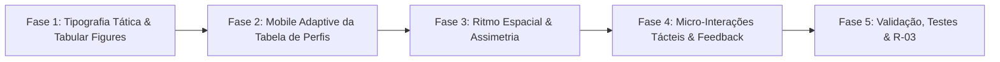

# 🎨 Plano de Execução: Melhoria da UX (Skill Impeccable)

> **Documento:** `PLANO_MELHORIA_UX_IMPECCABLE.md`  
> **Repositório:** `c:\apps\RKT-LP`  
> **Metodologia:** Impeccable Design + STE-DEV (R-03: arquivos $\le 100$ linhas)  
> **Status:** Aprovado para execução

---

## 1. Diretrizes de Contexto e Escopo

| # | Princípio | Aplicação no RKT-LP |
|---|---|---|
| **1** | **Propósito da Landing Page** | Ambiente de **descoberta, apresentação técnica e conversão**. O usuário consome a página em telas desktop e mobile em ambiente controlado (casa, escritório, vestiário). |
| **2** | **Descarte de Usabilidade Outdoor** | A anotação em tempo real sob luz solar intensa é feita exclusivamente no aplicativo (`sistema.rkt-app.com`). A landing page mantém sua paleta sofisticada e contraste equilibrado atual. |
| **3** | **Voz da Interface** | **Táctil** (linhas e placares de tênis), **Cirúrgica** (precisão nos números) e **Eletrizante** (tensão de match point, acentos pontuais em amarelo *Volt*). |
| **4** | **Frente de Simulação em Espera** | A telemetria interativa (*Show, Don't Tell*) será implementada posteriormente, quando os dados reais da partida forem fornecidos. |

---

## 2. Fases de Execução

---

### Fase 1: Tipografia Tática e Dígitos Tabulares (Legibilidade Cirúrgica)
* **Objetivo:** Eliminar saltos visuais e desalinhamentos de largura nos números de placar, percentuais e parciais.
* **Ações:**
  1. **Configuração de `tabular-nums`:**
     * Aplicar `font-variant-numeric: tabular-nums` e `font-feature-settings: 'tnum'` em:
       * Placares de sets e games (`HeroScoreboard.tsx` e `TelemetryDemo.tsx`).
       * Percentuais de saque, devolução e break points (`HeroServeCard.tsx`, `StatBar.tsx`).
       * Tabela de perfis e métricas de partida.
  2. **Escala Modular de Títulos com `clamp()`:**
     * Revisar os tokens de tipografia em `src/design-system/tokens/typography.ts` para garantir fluid sizing nos títulos sem quebras deselegantes de linha em telas intermediárias.
  3. **Teto de Comprimento de Leitura (Line Length):**
     * Garantir que nenhum parágrafo de texto corrido ultrapasse `65ch` a `75ch` (`max-w-prose` ou `max-w-2xl`), prevenindo fadiga de leitura.

---

### Fase 2: Redesenho Responsivo da Seção "Para Quem" (Mobile Touch)
* **Objetivo:** Eliminar o scroll horizontal forçado em celulares, proporcionando uma leitura agradável e fluida.
* **Ações:**
  1. **Layout Híbrido Responsivo (`TargetAudience.tsx`):**
     * **Desktop / Tablet ($\ge 640\text{px}$):** Mantém a tabela semântica estruturada (`<table>`, `<th>`), que é ideal para comparação direta.
     * **Mobile ($< 640\text{px}$):** Exibe um seletor tátil de perfis por abas largas (`Atleta` | `Treinador` | `Clube` | `Família`), permitindo alternar e visualizar diretamente a dor e o que o RKT resolve com um toque de polegar, sem atrito de barra de rolagem lateral.
  2. **Áreas de Toque Ergonométricas:**
     * Botões e seletores mobile com altura mínima de $44\text{px}$ a $48\text{px}$.

---

### Fase 3: Ritmo Espacial e Assimetria Editorial (Spatial Design)
* **Objetivo:** Romper a repetição uniforme de espaçamento vertical (`py-12 / py-16 / py-24`) e dar cadência viva à página.
* **Ações:**
  1. **Zonas de Densidade Alternadas:**
     * *Zonas Compactas e Técnicas:* Hero e Demonstração de Telemetria (espaçamentos mais justos, dados agrupados com foco tático).
     * *Zonas de Respiro Amplo:* Bloco emocional *"A paixão de acompanhar o jogo"* e bloco de indicação (*ShareBlock*), com respiro generoso para destacar a mensagem.
  2. **Alinhamentos Editoriais:**
     * Substituir blocos centralizados repetitivos por alinhamentos à esquerda com hierarquia visual forte, transmitindo maior seriedade analítica.

---

### Fase 4: Micro-Interações Tácteis e Feedback Acessível
* **Objetivo:** Respostas físicas e imediatas a cada clique, sem transições artificiais ou lentas.
* **Ações:**
  1. **Refinamento do Botão de Cópia (`ShareBlock.tsx`):**
     * Adicionar curva de desaceleração natural (`ease-out-quint` ou `cubic-bezier(0.16, 1, 0.3, 1)`).
     * Transição de ícone entre "Link" e "Check verde-volt" ao copiar.
     * Manter anúncio acessível em `aria-live="polite"`.
  2. **Zero Layout Shifts (CLS = 0):**
     * Todas as micro-transições restritas a aceleração por hardware (`transform` e `opacity`), sem animar propriedades de caixa (`height`, `width`, `padding`, `margin`).

---

### Fase 5: Validação, Suíte de Testes e STE-DEV
* **Ações:**
  1. **Auditoria R-03:** Cada arquivo criado ou refatorado deve permanecer estritamente em **$\le 100$ linhas**.
  2. **Testes Unitários:** Adicionar testes em `tests/` para verificar os seletores mobile e os estilos `tabular-nums`.
  3. **Verificação de Compilação:** `pnpm typecheck`, `pnpm test` e `pnpm build` com 100% de aprovação.

---

## 3. Fase Futura (Pausada até Envio de Dados)

* **Fase F: Telemetria Interativa Viva (Show, Don't Tell):**
  * Aguardando envio da massa real de dados da partida para alimentar a simulação de placar e rali interativo.

