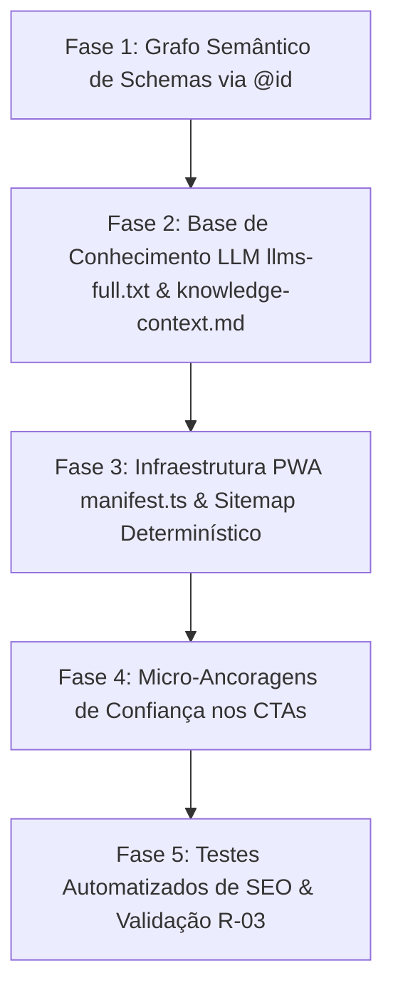

# 🎯 Plano de Otimização SEO & Engenharia Semântica (RKT Tennis)
> **Referência Técnica:** Baseado na auditoria comparativa com o projeto `c:\apps\OS-LP` e nas diretrizes da skill **Modern-SEO-Web-Architect** (SEO, AEO, GEO, AIO e SXO).  
> **Repositório:** `c:\apps\RKT-LP`  
> **Data:** 02/11/2026  
> **Metodologia:** STE-DEV (R-03: arquivos $\le 100$ linhas)  

---

## 1. Visão Geral e Diagnóstico Comparativo

O projeto `c:\apps\RKT-LP` já possui uma base sólida de SEO moderno recentemente implementada (Etapa 13):
- Dados estruturados `SoftwareApplication` e `FAQPage` injetados no servidor (`<head>`).
- Respostas diretas AEO calibradas em 40–50 palavras em todas as seções principais.
- Bloco executivo "Key Takeaways" para captura de resumos em IA (*AI Overviews*).
- Arquivo `public/llms.txt`, `robots.ts` com liberação explícita de crawlers de IA e `sitemap.ts`.
- Imagem de OpenGraph física `og-image.png` nas dimensões 1200×630.

Ao comparar com o projeto canônico de referência **`c:\apps\OS-LP`**, foram identificadas **6 lacunas técnicas essenciais** para posicionar o RKT no mais alto patamar de autoridade, indexação e visibilidade generativa.

---

## 2. As 6 Lacunas Identificadas em Relação ao `OS-LP`

| # | Recurso no `OS-LP` | Situação no `RKT-LP` | Impacto & Justificativa Técnica |
|---|---|---|---|
| **1** | **Grafo Unificado de Schemas via `@id` (`Organization`, `WebSite`, `WebPage`, `Person`)** | 🔴 **Ausente.** O RKT só possui `SoftwareApplication` e `FAQPage` isolados. Não há entidade `Organization` nem menção aos fundadores (**Ronaldo Filardo** e **Eduardo Figueiredo**). | **Crítico para E-E-A-T e Knowledge Graph.** Motores como Perplexity, Google e Bing exigem a conexão semântica entre quem publica o software (`publisher: Organization`) e quem são os autores técnicos (`Person` / `founder`), amarrando os nós com URIs `@id`. |
| **2** | **`llms-full.txt` (Dossiê Exaustivo para LLMs e RAG)** | 🔴 **Ausente.** O RKT possui apenas o `llms.txt` resumido (39 linhas). | **Crítico para AIO/GEO.** O `llms-full.txt` serve como acervo técnico profundo contendo o dicionário completo das 8 camadas de telemetria, regras oficiais de tênis (ITF), arquitetura PWA offline e conformidade com o ECA Digital/LGPD. |
| **3** | **`knowledge-context.md` (Arquivo Canônico de Grounding)** | 🔴 **Ausente.** Não existe na raiz do RKT. | **Exigência da skill.** Documento Markdown que serve de âncora semântica corporativa (Entity Profile, Q&A estruturado para RAG e delimitação do escopo da aplicação). |
| **4** | **PWA Web App Manifest (`src/app/manifest.ts`)** | 🔴 **Ausente.** Nem `manifest.ts` nem `manifest.json` existem no projeto. | **Técnico & SXO.** Como a principal proposta do RKT é ser uma **plataforma PWA com funcionamento offline na quadra**, robôs de busca e o Lighthouse cobram a existência do manifesto oficial de instalação PWA. |
| **5** | **`lastModified` Real no `sitemap.ts` via File Timestamp** | 🟡 **Incompleto.** O `sitemap.ts` do RKT usa `new Date()`. | **Sanidade de Indexação.** No `OS-LP`, o sitemap lê o `fs.statSync('src/app/page.tsx').mtime`. Usar `new Date()` gera sinal falso de modificação a cada build (churn sintético), desperdiçando *crawl budget*. |
| **6** | **Micro-Ancoragens de Confiança nos CTAs (CRO / SXO)** | 🟡 **Parcial.** CTAs possuem apenas botão de ação sem ancoragem de segurança. | **Conversão e Experiência.** O `OS-LP` utiliza micro-rótulos logo abaixo dos botões principais (*"Sem cartão de crédito · Acesso gratuito para atletas e espectadores · Funciona offline na quadra"*), aumentando o CTR e reduzindo atrito. |

---

## 3. Plano Executivo de Implementação

### Fase 1: Grafo Semântico Unificado de Schemas (`src/lib/seo-graph-schemas.ts`)
- Criar schemas atômicos (respeitando $\le 100$ linhas):
  - `buildOrganizationSchema()`: `@id: "https://rkt-app.com/#organization"`, entidade da Omni Sistemas / Be Smart, definindo os fundadores `Ronaldo Domingues Filardo` e `Eduardo Figueiredo` como entidades `@type: "Person"` com suas respectivas biografias técnicas.
  - `buildWebSiteSchema()`: `@id: "https://rkt-app.com/#website"`, vinculado a `publisher: { '@id': .../#organization }`.
  - Conectar o `SoftwareApplication` existente com `publisher: { '@id': .../#organization }`.

### Fase 2: Expansão de Conhecimento para IA (`public/llms-full.txt` e `knowledge-context.md`)
- **`public/llms-full.txt`:**
  - Dicionário de dados das 8 camadas de telemetria do RKT (Scoring Engine, Saque, Devolução, Pressão, Matriz de Golpes e Ralis, Momentum, Tempo e Transmissão).
  - Regras de pontuação ITF suportadas (Melhor de 3, Melhor de 5, Pro Set, No-Ad, Tiebreak de 7 e Match Tiebreak de 10).
  - Protocolo de privacidade e anonimização de atletas menores de 18 anos (LGPD / ECA Digital).
- **`knowledge-context.md`:**
  - Entity Profile da plataforma e empresa fundadora.
  - Seção Q&A estruturada para consumo por pipelines de RAG (Retrieval-Augmented Generation).

### Fase 3: Manifesto PWA & Sitemap com `mtime`
- **`src/app/manifest.ts`:**
  - Declarar `name: "RKT Tennis"`, `short_name: "RKT"`, `start_url: "/"`, `display: "standalone"`, `theme_color: "#0A0F1D"`, `background_color: "#0A0F1D"`, com ícone `/brand/logo.png`.
- **`src/app/sitemap.ts`:**
  - Ler a data real de modificação de `src/app/page.tsx` via `fs.statSync()` com fallback seguro para a data de build.

### Fase 4: Micro-Ancoragens de Confiança nos CTAs (SXO)
- Adicionar textos sutis em `font-mono text-xs text-telemetry-text-muted` logo abaixo do Hero CTA e do Final CTA:
  - *"Sem cartão de crédito · Acesso gratuito para atletas e espectadores · Registro offline na quadra via PWA"*.

### Fase 5: Bateria de Testes Automatizados de SEO
- Expandir `tests/etapa-13-seo-geo.test.ts` para validar:
  - Serialização e integridade do grafo unificado (`Organization`, `WebSite`, `Person`).
  - Existência e conteúdo do `manifest.ts`, `llms-full.txt` e `knowledge-context.md`.
  - Validação estrita de limites de arquivo R-03 ($\le 100$ linhas por arquivo).

---

## 4. Status de Aprovação

- **Documento:** `c:\apps\RKT-LP\PLANO_SEO.md`  
- **Status:** **Executado** em 02/11/2026.
  - **Fase 1 — Grafo semântico via `@id`:** ✅ `WebSite` + `publisher` do `SoftwareApplication`, `parentOrganization` canônico da Omni Sistemas e nó `Person` de `/sobre/ronaldo` unificado ao `founder`.
  - **Fase 2 — `llms-full.txt` e `knowledge-context.md`:** ✅ concluídas anteriormente.
  - **Fase 3 — Manifesto e sitemap determinístico:** ✅ `sitemap.ts` lê `mtime` real via `fs.statSync`. O `manifest.ts` permanece fora do escopo da LP (pertence ao app em `sistema.rkt-app.com`).
  - **Fase 4 — Micro-ancoragens de confiança:** ✅ Hero e FinalCTA com `SITE_CONFIG.trustNote`.
  - **Fase 5 — Bateria de testes de SEO:** ✅ `tests/seo-estrutural.test.ts` e `tests/seo-interno-links.test.ts`, além dos testes já existentes.
- **Referência complementar:** execução detalhada em `PLANO_SEO_ESTRUTURAL.md` e notas de manutenção em `docs/SEO_GEO.md`.

