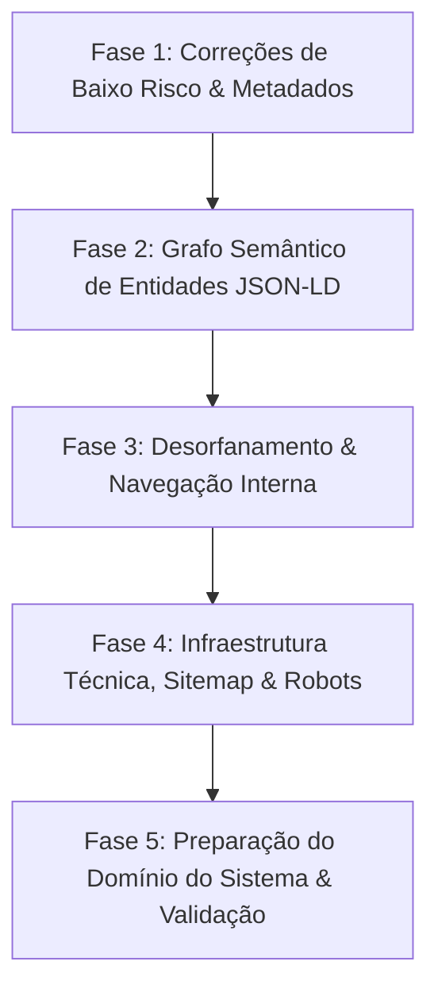

# 📋 Plano de Implementação: Otimização Estrutural, Grafo e SEO Técnico (RKT)

> **Documento:** `PLANO_SEO_ESTRUTURAL.md`  
> **Status:** ✅ **Executado em 02/11/2026** — 5 fases concluídas (registro em §6); Fase 5 estendida ao repositório do sistema em 03/11/2026.  
> **Escopo:** Exclusivamente arquitetura técnica, SEO/AEO/GEO, links internos, metadados e grafo JSON-LD.  
> **Exclusões:** A produção e publicação dos módulos em `/conhecimento` e artigos longos em `/artigos` ou `/guia` serão realizadas externamente pelo usuário.  
> **Diretrizes e Regras:** STE-DEV (R-03: arquivos $\le 100$ linhas), zero presunções não declaradas, baseline de testes verde contínua.

---

## 1. Premissas e Padronizações Canônicas

1. **Marca:** A marca canônica do sistema é **RKT** (substituindo repetições de "RKT Tennis" nas tags de título e identificadores semânticos para eliminar ambiguidade com "raquete/racket").
2. **Autoridade E-E-A-T (Fundador):** Ronaldo Filardo atua como arquiteto de software e engenheiro **desde 1996** (padronizado em todos os nós e textos, eliminando divergências com 1997).
3. **Fundador Associado:** Eduardo Figueiredo terá sua biografia e rota dedicada (`/sobre/eduardo`) inseridas em momento futuro. A estrutura de dados e esquemas já ficará preparada para recebê-lo.
4. **Domínio da Plataforma (`sistema.rkt-app.com`):** Será preparado preventivamente para quando for ativado em produção (isolamento canônico, headers de noindex nas áreas autenticadas e proteção de crawl budget).

---

## 2. Mapa de Fases de Implementação



---

## 3. Detalhamento Técnico por Fase

### Fase 1: Correções Imediatas de Metadados e Redação SERP
* **Objetivo:** Adequar títulos, descrições e hierarquia H1 para evitar truncamento em resultados de busca e maximizar relevância temática.
* **Ações:**
  1. **Template de Título no Root Layout (`src/app/layout.tsx`):**
     * Configurar `title: { default: 'RKT | Telemetria e Inteligência Tática no Tênis', template: '%s | RKT' }`.
     * Eliminar a alternância entre `| RKT` e `| RKT Tennis`.
  2. **Calibragem de Tamanho (SERP):**
     * Ajustar título de `/sobre/ronaldo` para $\le 60$ caracteres: `"Ronaldo Filardo | Fundador e Arquiteto | RKT"`.
     * Reduzir `description` da Home para 155 caracteres (atualmente 181, cortada pelo Google).
     * Reduzir `description` de `/sobre/ronaldo` para 155 caracteres (atualmente 202).
  3. **H1 da Home Semântico e Rico em Palavras-chave:**
     * Atualizar H1 em `src/components/hero/Hero.tsx` para incorporar termos prioritários de busca:  
       *Exemplo:* `"Telemetria de Tênis: Substitua a Intuição pela Precisão dos Dados de Partida"`.
  4. **Micro-Ancoragens de Confiança nos CTAs (CRO / SXO):**
     * Adicionar rótulos de baixa fricção abaixo dos botões do Hero e do Final CTA:  
       *`"Sem cartão de crédito · Gratuito para atletas e espectadores · Registro offline na quadra"`*.
  5. **Correção de `og:type` nas Páginas Internas:**
     * Alterar de `article` para `website` ou `profile` conforme a natureza da página (`/glossario` -> `website`, `/sobre/ronaldo` -> `profile`).

---

### Fase 2: Grafo Semântico Unificado de Entidades JSON-LD
* **Objetivo:** Conectar o RKT ao grafo de conhecimento da Omni Sistemas (`omni-sistemas.com`) e isolar schemas por escopo de rota.
* **Ações:**
  1. **Isolamento do `FAQPage` (Correção Estrutural Crítica):**
     * Remover `buildFaqPageSchema()` do `src/app/layout.tsx`.
     * Injetar o schema `FAQPage` exclusivamente em `src/app/page.tsx` (onde o componente FAQ está fisicamente renderizado), evitando duplicação em rotas filhas e penalização de qualidade no Google.
  2. **Nó `WebSite` com SearchAction:**
     * Adicionar gerador `buildWebSiteSchema()` com `@id: "https://rkt-app.com/#website"`.
     * Vincular `publisher: { '@id': "https://rkt-app.com/#organization" }`.
  3. **Conexão com a Desenvolvedora (`parentOrganization`):**
     * No `Organization` do RKT, declarar `parentOrganization` com:
       ```json
       {
         "@type": "Organization",
         "@id": "https://omni-sistemas.com/#organization",
         "name": "Omni Sistemas",
         "url": "https://omni-sistemas.com"
       }
       ```
  4. **Schema de Pessoa na Página Dedicada (`/sobre/ronaldo`):**
     * Criar schema `ProfilePage` e nó `Person` com `@id: "https://rkt-app.com/sobre/ronaldo#person"`.
     * Declarar `jobTitle`, `alumniOf`, `knowsAbout: ["ASD-STE100", "Engenharia Preventiva", "Tênis", "Telemetria Esportiva"]` e `sameAs`.
  5. **BreadcrumbList Automatizado:**
     * Injetar `BreadcrumbList` em todas as rotas internas (`/sobre`, `/sobre/ronaldo`, `/glossario`, `/guia/estatisticas-de-tenis`, `/para-*`).

---

### Fase 3: Desorfanamento e Interligação Interna
* **Objetivo:** Garantir que todas as páginas de conteúdo sejam indexadas e recebam fluxo de autoridade (*PageRank* interno).
* **Ações:**
  1. **Inclusão de `/sobre/ronaldo` nas Listas Globais:**
     * Registrar no array `SITE_PAGES` em `src/config/site.config.ts`.
     * Integrar no `sitemap.xml`, no `llms.txt`, no `llms-full.txt` e nos links do rodapé.
  2. **Interligação da Home com Páginas de Público:**
     * Atualizar os cards de `TargetAudience` para que seus títulos/links direcionem para `/para-atletas`, `/para-treinadores` e `/para-gestores` (em vez de apontar diretamente para o cadastro). O botão de ação secundário mantém o cadastro.
  3. **Links Contextuais no Corpo do Conteúdo:**
     * Adicionar no corpo do Hero e das seções de telemetria links naturais para `/guia/estatisticas-de-tenis` e `/glossario`.
     * No guia de estatísticas, adicionar hiperlinks nos termos técnicos (ex: *ace*, *break point*, *erro não forçado*) apontando para suas respectivas âncoras no `/glossario`.
  4. **Bloco "Veja Também" / Navegação Relacionada:**
     * Adicionar ao final de cada página de conteúdo uma lista de links para os tópicos correlatos.

---

### Fase 4: Infraestrutura Técnica, Sitemap & Robots
* **Objetivo:** Otimizar o rastreamento dos robôs e eliminar diretivas obsoletas.
* **Ações:**
  1. **Sitemap Determinístico com `mtime` Real:**
     * Refatorar `src/app/sitemap.ts` para ler o `mtime` real dos arquivos de rota (`fs.statSync`) em vez de gerar `new Date()` em todo build.
  2. **Limpeza do `robots.ts`:**
     * Remover a propriedade obsoleta `host` do retorno de `src/app/robots.ts`, mantendo apenas regras padronizadas (`User-agent`, `Allow`, `Disallow`, `Sitemap`).
  3. **Reconciliação Documental:**
     * Atualizar `PLANO_SEO.md` e sincronizar com `docs/SEO_GEO.md`, marcando como concluídos os itens já implementados (`ScrollProgressBar`, `llms-full.txt`, `Organization`).

---

### Fase 5: Preparação Preventiva do Domínio do Sistema (`sistema.rkt-app.com`)
* **Objetivo:** Blindar o futuro ambiente autenticado para não canibalizar a Landing Page nem indexar dados vazios.
* **Ações:**
  1. **Regras de Robots e Headers no Domínio do Sistema:**
     * Configurar `X-Robots-Tag: noindex, nofollow` para todas as telas sob `/app/`, `/admin/` e fluxos de recuperação.
  2. **Metadados Canônicos para Rotas Públicas do Sistema:**
     * As páginas legais (`/termos`, `/privacidade`) e de autenticação (`/login`, `/cadastro`) do futuro sistema deverão conter títulos descritivos próprios (ex: *"Acesse sua Conta \| RKT"* e *"Termos de Uso \| RKT"*).

---

## 4. Matriz de Arquivos Impactados

| Arquivo | Ação Prevista | Limite R-03 |
|---|---|---|
| `src/app/layout.tsx` | Mover `FAQPage` para a home; adicionar template de título. | $\le 100$ linhas |
| `src/app/page.tsx` | Injetar `FAQPage` e nó `WebSite`. | $\le 100$ linhas |
| `src/app/robots.ts` | Remover diretiva obsoleta `host`. | $\le 100$ linhas |
| `src/app/sitemap.ts` | Utilizar `fs.statSync` para `lastModified` real. | $\le 100$ linhas |
| `src/config/site.config.ts` | Incluir `/sobre/ronaldo` e calibrar textos da home. | $\le 100$ linhas |
| `src/data/content/ronaldo.data.ts` | Padronizar data (1996) e encurtar description. | $\le 100$ linhas |
| `src/lib/seo-schema.ts` | Suporte a nós `@id`, `parentOrganization` e `BreadcrumbList`. | $\le 100$ linhas |
| `src/components/hero/Hero.tsx` | Ajustar H1 com palavras-chave e micro-ancoragem de confiança. | $\le 100$ linhas |
| `src/components/cta/FinalCTA.tsx` | Adicionar micro-ancoragem de confiança. | $\le 100$ linhas |
| `src/components/audience/AudienceCard.tsx` | Linkar card diretamente para `/para-*`. | $\le 100$ linhas |

---

## 5. Protocolo de Verificação Pós-Execução
Toda execução deste plano deverá passar por:
1. `node scripts/check-r03.mjs` (100% dos arquivos $\le 100$ linhas).
2. `pnpm typecheck` (zero erros TypeScript).
3. `pnpm test` (suite de testes atualizada cobrindo os novos schemas e links).
4. `pnpm build` (build estático 100% verde gerando todas as rotas).

---

## 6. Registro de Execução (02/11/2026)

**Protocolo de verificação — 100% verde:**

| Verificação | Resultado |
|---|---|
| `node scripts/check-r03.mjs` | ✅ 90 arquivos em `src/`, todos $\le 100$ linhas |
| `pnpm typecheck` | ✅ zero erros TypeScript |
| `pnpm test` | ✅ **122 testes** passando (19 novos) |
| `pnpm build` | ✅ build estático, 14 páginas geradas |

**Fases concluídas:**

| Fase | Evidência |
|---|---|
| **1 — Metadados** | `title.template` com sufixo canônico (`TITLE_SUFFIX`), H1 da Home com "Telemetria de tênis", `trustNote` no Hero e no FinalCTA, descriptions de 155 caracteres, `og:type` por natureza da página (`website`/`article`/`profile`). |
| **2 — Grafo JSON-LD** | `FAQPage` isolada na home; nó `WebSite` + `publisher` no `SoftwareApplication`; `parentOrganization` com `@id` da Omni Sistemas; `ProfilePage` + `Person` em `/sobre/ronaldo` com `@id` unificado ao nó `founder`; `BreadcrumbList` nas 7 rotas internas. |
| **3 — Desorfanamento** | `/sobre/ronaldo` em `SITE_PAGES` (sitemap, `llms.txt`, `llms-full.txt`, rodapé); títulos dos cards de público → `/para-*`; links Hero/telemetria → guia e glossário; termos técnicos do guia → âncoras do glossário; bloco "Veja também" em toda página de conteúdo. |
| **4 — Infraestrutura** | `sitemap.ts` com `mtime` real via `fs.statSync`; `host` removido do `robots.ts`; `PLANO_SEO.md` e `docs/SEO_GEO.md` reconciliados. |
| **5 — Sistema** | LP: `X-Robots-Tag: noindex, nofollow` em `/app/*` e `/admin/*` via `next.config.mjs`. Sistema (`C:\apps\RKT`): header replicado no `next.config.ts` para todas as telas autenticadas e fluxos de recuperação; títulos próprios em `/termos`, `/privacidade`, `/login` e `/signup`. |

**Desvios declarados (regra de zero presunções):**
- **`SearchAction` não foi emitido:** a landing page não possui endpoint de busca — declarar ação para rota inexistente seria dado falso. O nó `WebSite` foi criado com `@id` e `publisher`, conforme a ação 2 desta fase.
- **`alumniOf` de Ronaldo** aponta para a *Universidade do Porto* (doutoramento documentado em `content/conhecimento/7-sobre-ronaldo-domingues-filardo.md`); nenhuma instituição foi inventada.
- **Card "Espectador / Pais"** permaneceu sem link de título: não existe página `/para-espectadores` neste escopo.
- **`SITE_CONFIG.name`** continua "RKT Tennis" (marca de prosa, usada em `llms.txt` e `humans.txt`); a padronização para **RKT** vale para as *tags de título*, conforme a premissa 1.
- **Pendências no repositório do sistema** (`sistema.rkt-app.com`): ✅ **concluído em 03/11/2026** — header `X-Robots-Tag` replicado em `/admin/*`, nas demais telas autenticadas (espelho do matcher do middleware) e nos fluxos de recuperação (`/forgot`, `/trocar-senha`); títulos próprios definidos para `/termos`, `/privacidade`, `/login` e `/signup` (rota real de cadastro).

